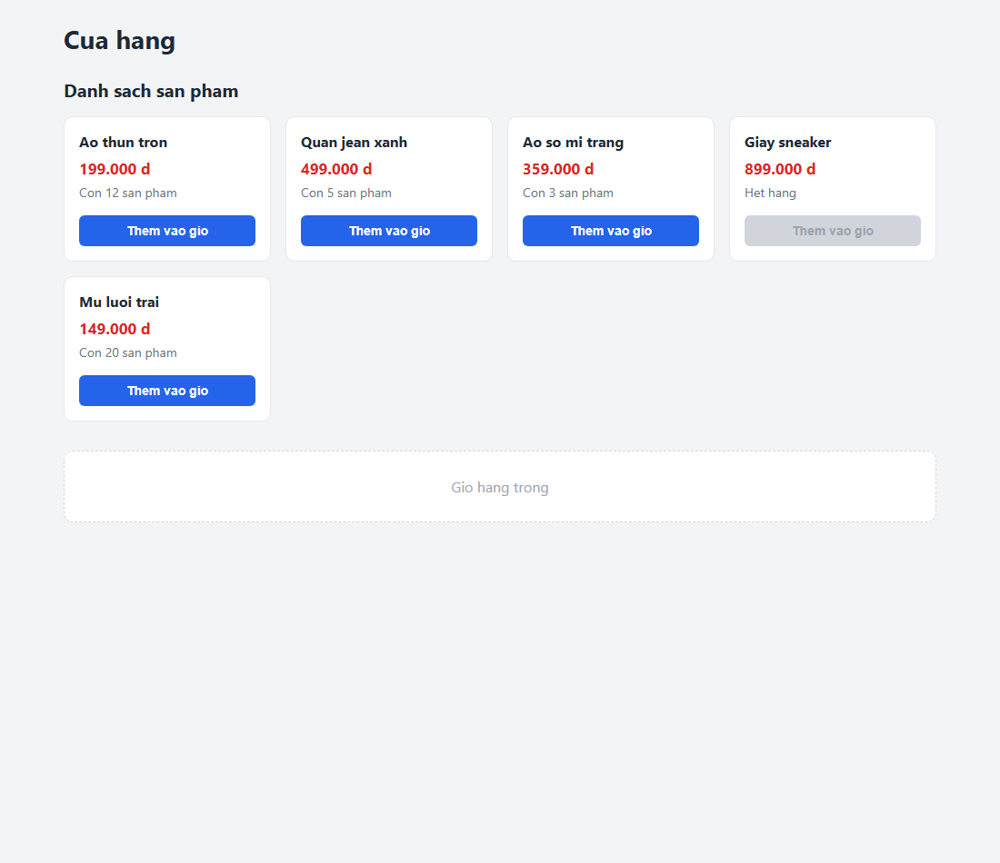
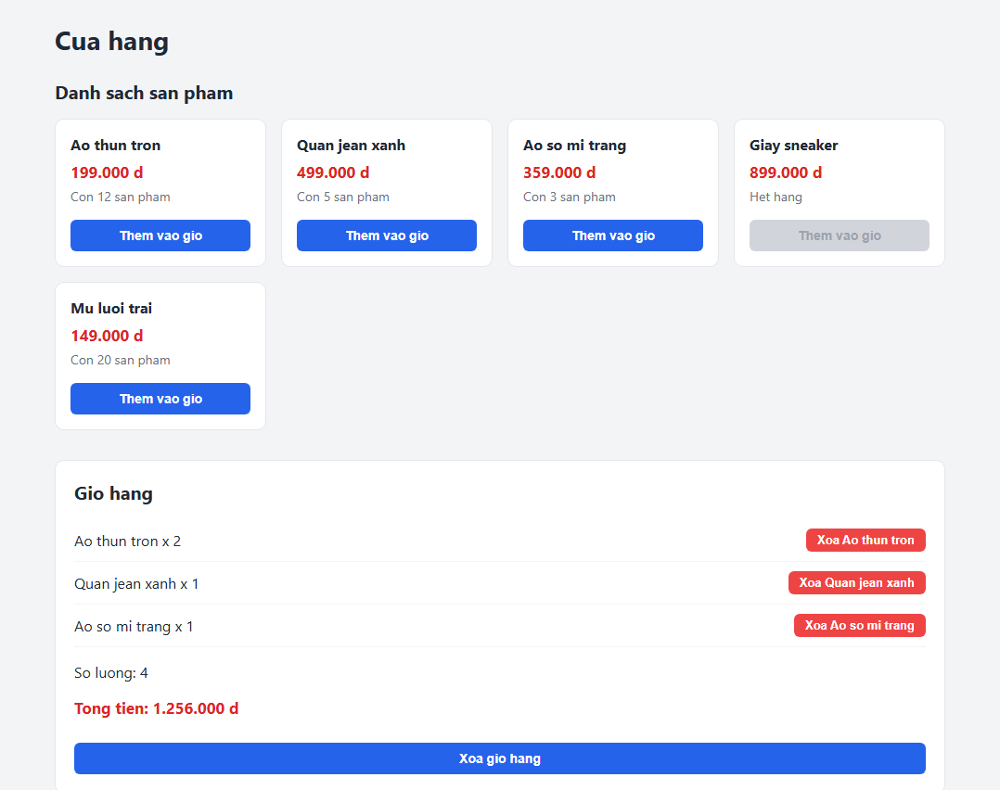
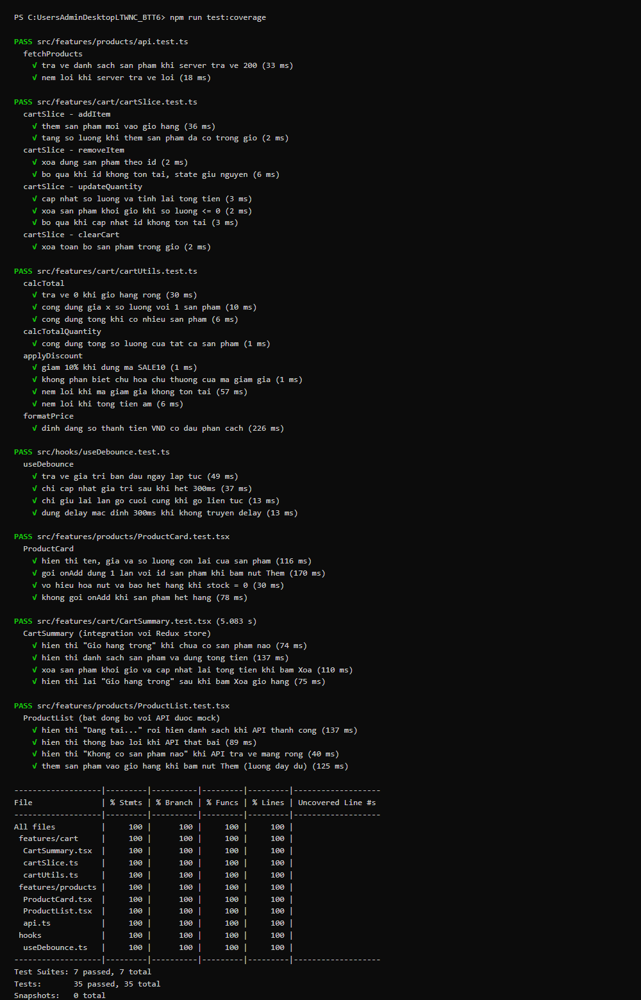
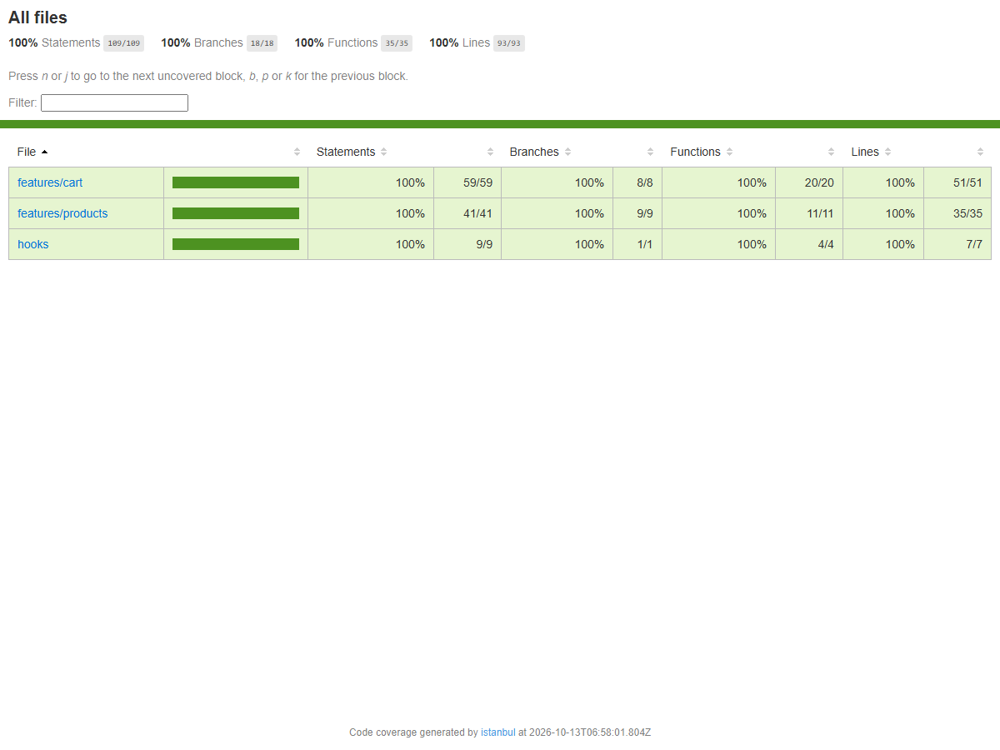

# BÀI TẬP TUẦN 6 — KIỂM THỬ ỨNG DỤNG FRONTEND VỚI TYPESCRIPT

Học phần: Lập trình Web nâng cao
Giảng viên: Ngô Văn Nhận

---

## 1. Đề bài

Viết bộ test cho module giỏ hàng/sản phẩm đã xây từ Buổi 3–4, tối thiểu 10 test case
gồm unit và integration, có ít nhất 1 test bất đồng bộ với API được mock, chạy
`jest --coverage` đạt ≥ 70%.

Module em chọn để kiểm thử là module **Giỏ hàng / Sản phẩm** đã làm ở Buổi 3–4
(dùng Redux Toolkit).

## 2. Cài đặt và chạy

Em cài Jest và React Testing Library theo hướng dẫn trong slide:

```bash
npm install -D jest ts-jest @types/jest jest-environment-jsdom
npm install -D @testing-library/react @testing-library/jest-dom @testing-library/user-event
```

Để chạy bài, thầy mở terminal ở thư mục này rồi gõ:

```bash
npm install
npm test                # chạy toàn bộ test
npm run test:coverage   # chạy test kèm báo cáo coverage
```

Cấu hình nằm ở `jest.config.ts` (preset `ts-jest`, môi trường `jsdom`) và
`jest.setup.ts` (import `@testing-library/jest-dom` một lần cho cả dự án).

## 3. Các test em đã viết

Em viết được tổng cộng **35 test** chia vào 7 file, đặt cạnh file nguồn theo đúng
quy ước `*.test.ts` / `*.test.tsx` trong slide.

**Unit test cho hàm** — `src/features/cart/cartUtils.test.ts` (9 test)
Em test hàm `calcTotal` với giỏ rỗng, một sản phẩm và nhiều sản phẩm; test
`calcTotalQuantity`, `formatPrice`. Riêng `applyDiscount` em test cả trường hợp mã
giảm giá sai và tổng tiền âm thì phải ném lỗi, dùng matcher `toThrow`.

**Unit test cho reducer** — `src/features/cart/cartSlice.test.ts` (8 test)
Reducer là hàm thuần nên em gọi trực tiếp `cartReducer(state, action)` rồi so sánh
state mới, không cần render React. Ngoài các trường hợp thường, em test thêm mấy
trường hợp biên như thêm sản phẩm đã có trong giỏ thì tăng số lượng, xoá id không
tồn tại thì state giữ nguyên, cập nhật số lượng về 0 thì xoá khỏi giỏ.

**Unit test cho custom hook** — `src/hooks/useDebounce.test.ts` (4 test)
Em dùng `renderHook` và `jest.useFakeTimers()` + `advanceTimersByTime(300)` để khỏi
phải chờ thật 300ms, test xem hook có chỉ giữ lần gõ cuối cùng không.

**Unit test cho hàm gọi API** — `src/features/products/api.test.ts` (2 test)
Em mock `fetch` để test hàm `fetchProducts` ở cả hai nhánh: server trả về 200 và
server trả về lỗi.

**Integration test cho component** — `src/features/products/ProductCard.test.tsx` (4 test)
Em render component bằng RTL rồi kiểm tra như người dùng: tìm nút bằng
`getByRole('button', { name: 'Them vao gio' })`, dùng `userEvent.click` và
`jest.fn()` để kiểm tra `onAdd` được gọi đúng 1 lần với đúng id. Em cũng test
trường hợp hết hàng thì nút phải bị `disabled`.

**Integration test component với Redux store** — `src/features/cart/CartSummary.test.tsx` (4 test)
Em viết hàm `renderWithProviders` trong `src/test-utils/` để bọc `<Provider>`, mỗi
test tạo store mới kèm `preloadedState` nên các test không ảnh hưởng lẫn nhau. Em
kiểm tra kết quả qua giao diện (text hiển thị) chứ không đọc trực tiếp store.

**Test bất đồng bộ với API được mock** — `src/features/products/ProductList.test.tsx` (4 test)
Đây là phần đáp ứng yêu cầu test bất đồng bộ. Em dùng `jest.mock('./api')` để thay
cả module API bằng bản giả, rồi dùng `mockResolvedValue` / `mockRejectedValue` để
giả lập thành công và lỗi. Em test đủ 3 trạng thái: lúc đầu hiện "Đang tải...",
sau đó dùng `findByText` để chờ danh sách hiện ra, và khi API lỗi thì
`findByRole('alert')` phải thấy thông báo lỗi. Test cuối em kiểm tra luồng đầy đủ
từ API về tới việc bấm nút thêm sản phẩm vào giỏ.

## 4. Giao diện module em đem đi test

Để thầy dễ hình dung các test đang kiểm tra cái gì, em chạy `npm run dev` và chụp
lại màn hình. Sản phẩm "Giay sneaker" hết hàng nên nút bị mờ và không bấm được —
đúng trường hợp em test `toBeDisabled` ở `ProductCard.test.tsx`:



Sau khi bấm thêm vài sản phẩm (sản phẩm đầu bấm 2 lần nên gộp thành 1 dòng số
lượng 2 — đúng như test `addItem` của reducer):



## 5. Báo cáo coverage

Kết quả khi em chạy `npm run test:coverage`:



Báo cáo dạng HTML ở `coverage/lcov-report/index.html`:



Cả 7 file test đều pass, 35/35 test pass và coverage đạt **100%** ở cả 4 chỉ số
Statements, Branches, Functions, Lines — vượt mức ≥ 70% mà đề bài yêu cầu. Trong
`jest.config.ts` em cũng đặt `coverageThreshold` là 70% như trong slide để nếu sau
này coverage tụt xuống thì Jest sẽ báo đỏ.

## 6. Một số chỗ em bị vướng khi làm

Lúc đầu chạy `npx jest` thì bị báo lỗi `'ts-node' is required for the TypeScript
configuration files`, em tìm hiểu thì do file `jest.config.ts` viết bằng TypeScript
nên phải cài thêm `ts-node` mới đọc được.

Chỗ thứ hai là khi test hàm `fetchProducts`, em định dùng `jest.spyOn(global, 'fetch')`
như slide hướng dẫn phần spyOn nhưng bị lỗi `Property 'fetch' does not exist`. Em
tìm hiểu thì do môi trường `jsdom` không có sẵn `fetch`, nên em gán trực tiếp
`globalThis.fetch = jest.fn()` thay vì dùng `spyOn`.

## 7. Những điều em học được

Em thấy rõ nhất là việc test theo hành vi người dùng (tìm phần tử bằng
`getByRole`, `getByText`) làm test bền hơn nhiều so với đọc state nội bộ — lúc em
sửa lại cấu trúc component thì test vẫn xanh. Em cũng hiểu là coverage 100% không
có nghĩa là code không còn lỗi, nó chỉ cho biết dòng nào chưa được test chạy qua,
nên em tập trung test thêm các nhánh lỗi và trường hợp biên như giỏ hàng rỗng, xoá
id không tồn tại, API thất bại.
